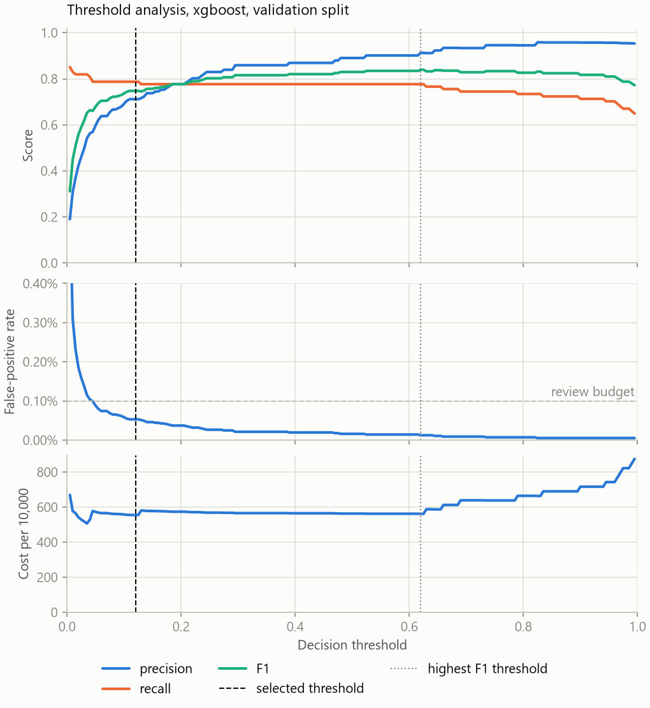
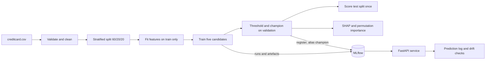
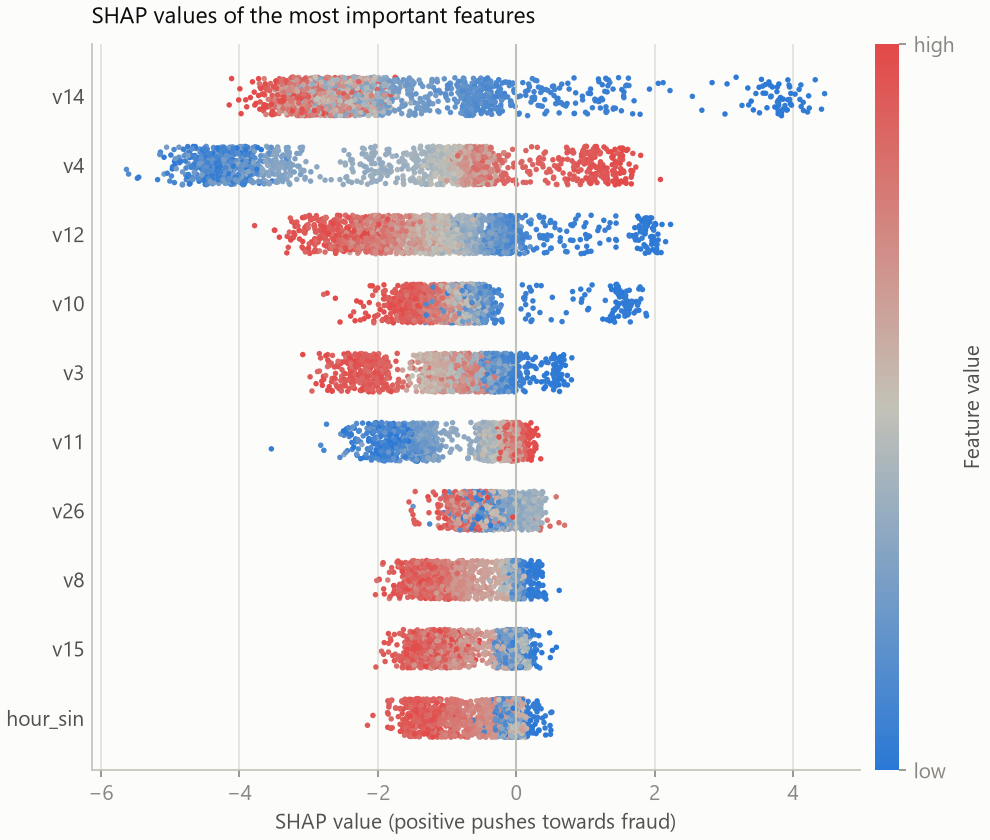

# fraudguard

fraudguard detects fraudulent card transactions. It compares several models on the public credit card fraud dataset from Kaggle, picks a decision threshold from explicit business costs, registers the best model in MLflow, and serves it from a FastAPI service with input validation, per-prediction explanations, and drift monitoring.

The repository is organised like a small production system: a typed Python package with tests, a reproducible training pipeline, experiment tracking and a model registry, a container image, CI, and a live deployment.

**Live demo: https://fraudguard-495192213241.europe-west1.run.app**. Pick a transaction from the held-out test set to see the decision and the features behind it, or call the API from its [documentation page](https://fraudguard-495192213241.europe-west1.run.app/docs). It runs on Google Cloud Run and scales to zero when idle, so the first request after a quiet spell takes about 20 seconds while a container starts.



## Contents

- [Business problem](#business-problem)
- [How it works](#how-it-works)
- [Results](#results)
- [Dataset](#dataset)
- [Getting started](#getting-started)
- [API](#api)
- [Monitoring](#monitoring)
- [Deployment](#deployment)
- [Project structure](#project-structure)
- [Limitations](#limitations)
- [Future improvements](#future-improvements)
- [Ethical considerations](#ethical-considerations)

## Business problem

A card issuer has to approve or stop each payment within milliseconds. Two kinds of mistake are possible, and they do not cost the same:

- **Missed fraud** is a direct loss plus chargeback handling.
- **A false alert** blocks or challenges a legitimate customer and takes an analyst's time in the review queue.

Fraud is rare: 0.17% of transactions in this dataset. A model that never flags anything is 99.83% accurate and catches nothing, so accuracy is not used anywhere in this project. Models are compared on how well they rank fraud above legitimate transactions (PR-AUC), and the decision threshold follows from three assumptions in `config/config.yaml`:

| Assumption | Value |
| --- | --- |
| Cost of a missed fraud | 150 |
| Cost of a false alert | 5 |
| Review capacity | False alerts on at most 0.1% of legitimate transactions |

The selected threshold is the cheapest one that fits the review capacity. The values are illustrative; an issuer would set them from its own loss and operations data.

## How it works



1. **Validate.** Schema, missing values, invalid values, duplicates, and class balance are checked. A blocking failure stops the run.
2. **Prevent leakage.** Duplicates are removed before splitting, a guard checks that no input appears in two splits, and every preprocessing step is fitted on the training split only.
3. **Train.** Logistic regression and a random forest with class weights, XGBoost with `scale_pos_weight`, XGBoost with SMOTE applied inside the training fit only, and an unweighted XGBoost as a control.
4. **Choose a threshold** for each candidate on the validation split with the cost rule above, and pick the champion by validation PR-AUC.
5. **Evaluate once** on the untouched test split, with bootstrap confidence intervals.
6. **Explain** the champion with SHAP values and permutation importance.
7. **Register** the champion in MLflow and point the `champion` alias at it. The API serves whichever version the alias points to.

[docs/architecture.md](docs/architecture.md) describes each step, the MLflow layout, and the service design.

## Results

All numbers come from [docs/evaluation_report.md](docs/evaluation_report.md), which the training run generates from the full public dataset.

### Candidates on the validation split

| Candidate | Imbalance handling | PR-AUC | ROC-AUC | Threshold | Precision | Recall | False-positive rate |
| --- | --- | --- | --- | --- | --- | --- | --- |
| Logistic regression | Class weights | 0.691 | 0.961 | 0.990 | 0.574 | 0.787 | 0.097% |
| Random forest | Class weights | 0.788 | 0.953 | 0.165 | 0.576 | 0.809 | 0.099% |
| **XGBoost** | `scale_pos_weight` | **0.803** | 0.965 | 0.120 | 0.712 | 0.787 | 0.053% |
| XGBoost | No weighting | 0.802 | 0.972 | 0.010 | 0.630 | 0.798 | 0.078% |
| XGBoost | SMOTE | 0.798 | 0.970 | 0.105 | 0.585 | 0.809 | 0.095% |

### Champion on the test split

| Metric | Value | 95% bootstrap interval |
| --- | --- | --- |
| PR-AUC | 0.866 | 0.800 to 0.929 |
| ROC-AUC | 0.978 | 0.953 to 0.994 |
| Precision at threshold 0.120 | 0.853 | 0.780 to 0.922 |
| Recall at threshold 0.120 | 0.853 | 0.783 to 0.922 |
| False-positive rate | 0.025% | |
| Expected cost per 10,000 transactions | 382 | 199 to 568 |

Of 95 fraud cases in the test split, 81 are caught and 14 are missed, while 14 of 56,651 legitimate transactions are flagged. Without a model, the expected cost is 2,511 per 10,000 transactions.

How to read these numbers:

- **The three XGBoost variants are not meaningfully different.** Class weighting beat the unweighted control by 0.0015 PR-AUC on a validation split with 94 fraud cases. Weighting mostly shifts the scores upwards: the two reach similar operating points at thresholds of 0.120 and 0.010. SMOTE did not help.
- **The test results are better than validation**, with a PR-AUC of 0.866 against 0.803. The validation figure lies inside the test interval, so the gap is sampling noise rather than evidence that the model generalises better than measured.
- **The estimates come from the collection period.** The split is random within two days of 2013 data, so performance on later transactions is unknown.

SHAP ranks `v14`, `v4`, `v12`, `v10`, and `v3` highest, and permutation importance broadly agrees. Of the engineered features, the hour of day contributes most. The components are anonymised, so the explanations can say which component drove a score but not what it means.



## Dataset

[Credit Card Fraud Detection](https://www.kaggle.com/datasets/mlg-ulb/creditcardfraud), published on Kaggle by the Machine Learning Group of the Université Libre de Bruxelles.

| Property | Value |
| --- | --- |
| Transactions | 284,807 made over two days in September 2013 by European cardholders |
| Fraud cases | 492, or 0.17% |
| Columns | `Time`, `Amount`, 28 principal components `V1` to `V28`, and the label `Class` |
| Licence | Open Database License for the database, Database Contents License for its contents, as stated on the Kaggle page |

The principal components hide the original attributes for confidentiality, which limits both feature engineering and explanation. [docs/feature_dictionary.md](docs/feature_dictionary.md) documents every column and feature.

The dataset authors ask users to cite: Andrea Dal Pozzolo, Olivier Caelen, Reid A. Johnson, and Gianluca Bontempi. *Calibrating Probability with Undersampling for Unbalanced Classification.* IEEE Symposium on Computational Intelligence and Data Mining, 2015.

### Getting the data

The file is about 144 MB and is not committed. Download it from Kaggle, which requires an account, and save it as:

```text
data/raw/creditcard.csv
```

TensorFlow hosts a copy of the same file that needs no account:

```bash
curl -L -o data/raw/creditcard.csv https://storage.googleapis.com/download.tensorflow.org/data/creditcard.csv
```

The copy used for the published results has SHA-256 `76274b691b16a6c49d3f159c883398e03ccd6d1ee12d9d8ee38f4b4b98551a89`. Every training run records the hash of its input file in MLflow.

### Synthetic sample data

`make sample-data` writes a synthetic file with the same columns to `data/raw/sample_transactions.csv`. Its fraud rows have shifted components, a mix of tiny card-testing amounts and larger purchases, and a flatter time-of-day profile. The tests, CI, and the Docker stack use it so that they run without the real file. Metrics on synthetic data say nothing about real fraud.

## Getting started

### Requirements

- Python 3.12 or newer and [uv](https://docs.astral.sh/uv/) 0.13 or newer
- GNU Make, optional because each target is one uv command. On Windows, `winget install ezwinports.make` installs it.
- Docker with Compose, optional

### Install

From the repository root:

```bash
make install
```

This creates `.venv` from `uv.lock` and installs the pre-commit hooks.

### Train

```bash
make train          # real data in data/raw/creditcard.csv
make train-sample   # synthetic data, generated first
```

On a laptop the full dataset takes about three minutes. The output:

```text
Loading dataset
Loaded 284,807 rows from data/raw/creditcard.csv
Validating schema
Check schema passed: All 31 required columns present
Check missing_values passed: No missing input values
Check duplicates warning: 1,081 duplicate rows (0.38%) will be dropped before splitting
Check value_ranges passed: All values within valid ranges
Check class_balance passed: 492 fraud rows (0.173%)
Cleaning and splitting data
Split 283,726 rows into train 170,235, validation 56,745, test 56,746
Fitting preprocessor on the training split
Training logistic_regression
Validation PR-AUC 0.6913, ROC-AUC 0.9612, threshold 0.990
Training random_forest
Validation PR-AUC 0.7879, ROC-AUC 0.9532, threshold 0.165
Training xgboost
Validation PR-AUC 0.8031, ROC-AUC 0.9654, threshold 0.120
Training xgboost_unweighted
Validation PR-AUC 0.8016, ROC-AUC 0.9717, threshold 0.010
Training xgboost_smote
Validation PR-AUC 0.7984, ROC-AUC 0.9703, threshold 0.105
Selecting champion
Champion is xgboost
Evaluating champion on the test split
Explaining champion predictions
Registering champion
Registered fraudguard version 1 with alias champion
Saving artefacts
Decision threshold 0.120
Test PR-AUC 0.8658, precision 0.8526, recall 0.8526
Report written to reports/evaluation_report.md
Done
```

The report, figures, and CSV and JSON summaries go to `reports/`. MLflow keeps runs in `mlflow.db` and artefacts in `mlartifacts/`. Passing `--publish_docs` to `scripts/train_model.py` also copies the report and figures into `docs/`.

To browse runs, metrics, figures, and registered versions:

```bash
make mlflow-ui   # http://127.0.0.1:5000
```

The exploratory analysis behind the feature choices is in `notebooks/exploratory_analysis.ipynb`. `make notebook` installs the optional notebook dependencies and opens it in JupyterLab.

### Test and lint

```bash
make test   # pytest with coverage, fails below 90%
make lint   # ruff and mypy in strict mode
```

The 104 tests cover 97% of the package. One fixture trains the whole pipeline on synthetic data in a temporary MLflow store, so the suite needs neither the real dataset nor network access.

### Serve

```bash
make serve   # http://127.0.0.1:8000, interactive documentation at /docs
```

The service loads the version behind the `champion` alias when it starts, so train first. With `FRAUDGUARD_MODEL_BUNDLE` set to a bundle from `make bundle`, it loads that instead and serves the demo page at `/`; see [Deployment](#deployment).

### Docker

```bash
docker compose up --build
```

This starts an MLflow server on port 5000, runs a training job on synthetic data against it, and then starts the API on port 8000. To train the stack on the real file instead, put it in `data/raw/` and run:

```bash
docker compose run --rm train python scripts/train_model.py
docker compose restart api
```

`make docker-build` builds the image on its own.

## API

| Method and path | Description |
| --- | --- |
| `POST /predict` | Score one transaction. Add `?explain=false` to skip the explanation. |
| `GET /health` | `200` with the model version, or `503` when no model is loaded |
| `GET /metrics` | Prediction counts, flagged rate, latency, input statistics, and drift status |
| `GET /docs` | Interactive OpenAPI documentation |
| `GET /` | Demo page that scores test transactions through `/predict` |
| `GET /demo/examples` | The demo transactions and test metrics, empty unless the model came from a bundle |

A fraud case from the test split, with an amount of 1.00:

```bash
curl -s http://127.0.0.1:8000/predict \
  -H 'Content-Type: application/json' \
  -H 'X-Request-ID: checkout-7f3a9c' \
  -d '{
    "time_seconds": 77202.0, "amount": 1.0,
    "v1": -0.3563, "v2": 1.4353, "v3": -0.8136, "v4": 1.9931, "v5": 2.0559,
    "v6": -0.5436, "v7": 0.4877, "v8": 0.0854, "v9": -0.5364, "v10": -2.2312,
    "v11": 0.274, "v12": -0.5358, "v13": 0.5957, "v14": -5.1418, "v15": 0.7324,
    "v16": 0.6239, "v17": 4.091, "v18": 1.6341, "v19": 0.2608, "v20": 0.3033,
    "v21": -0.3129, "v22": -0.6879, "v23": -0.267, "v24": -1.1585, "v25": 0.2715,
    "v26": -0.1554, "v27": 0.1143, "v28": 0.1015
  }'
```

Response:

```json
{
  "request_id": "checkout-7f3a9c",
  "fraud_probability": 0.8589519262313843,
  "predicted_label": "fraud",
  "decision_threshold": 0.12,
  "model_name": "fraudguard",
  "model_version": "1",
  "latency_ms": 23.189,
  "explanation": {
    "base_value": 3.1046624183654785,
    "output_unit": "log_odds",
    "contributions": [
      {"feature": "v14", "value": -5.369548809855465, "contribution": 3.4995181560516357},
      {"feature": "v10", "value": -2.0788860820056354, "contribution": 1.6849218606948853},
      {"feature": "v4", "value": 1.4029943515583532, "contribution": 1.1517996788024902},
      {"feature": "v15", "value": 0.8016774008834291, "contribution": -1.123733401298523},
      {"feature": "v24", "value": -1.913909837972859, "contribution": -0.9961696267127991}
    ]
  }
}
```

Reading the response:

- `fraud_probability` is a model score. Class weighting pushes it above the true probability of fraud, so decisions should use `predicted_label`, which applies the threshold chosen during training.
- `contributions` are SHAP values in log-odds: positive values push towards fraud. `value` is the standardised input, so `v14` here sits more than five standard deviations below the training mean.
- `base_value` plus all 32 contributions equals the raw model output. It reflects the class mix the model was trained on, and class weighting made that mix roughly balanced, so it sits far above a typical score. Compare contributions between transactions rather than reading the base value as an average.

Invalid input returns `422` with the failing fields. The submitted values are not echoed back:

```json
{
  "detail": [
    {"loc": ["body", "v14"], "msg": "Field required", "type": "missing"},
    {"loc": ["body", "amount"], "msg": "Input should be greater than or equal to 0", "type": "greater_than_equal"}
  ],
  "request_id": "aef54541d7164192a62f654339d01e13"
}
```

Every response carries an `X-Request-ID` header, and every log line about the request includes the same id. Unhandled errors return a generic `500` and the traceback stays in the log.

On a laptop, scoring takes about 24 ms at the median with the explanation and 15 ms without. The first request after startup is slower.

In Windows PowerShell, call `curl.exe` instead of `curl` and pass the body from a file with `--data '@request.json'`, or send requests from the interactive documentation at `/docs`.

## Monitoring

The API appends every prediction to `data/monitoring/predictions.jsonl`. `GET /metrics` reports:

- prediction and flag counts, and the flagged rate
- latency percentiles and input statistics over the last 5,000 predictions
- drift: the population stability index of `amount` and `v1` to `v28` against quantile bins from the training split, which are stored with the model. A PSI of 0.1 raises a warning and 0.25 an alert. Nothing is reported until 200 predictions have been seen.

State is kept in memory, so it is per process and resets on restart. [docs/architecture.md](docs/architecture.md#extending-to-prometheus-and-grafana) describes how the same signals would move to Prometheus and Grafana.

## Deployment

The live demo runs on Google Cloud Run. The local MLflow registry cannot travel with the code, so `make bundle` exports the champion, its test metrics, and six test-split transactions into a self-contained bundle. `make deploy` then builds an image around it with Cloud Build and rolls out a new revision, labelled with the commit and model version.

```bash
make bundle
make deploy
```

The service runs on 1 vCPU and 1 GiB and scales between zero and one instance, which keeps it inside the free tier and bounds the cost of any traffic spike. CI builds the same image from a model trained on synthetic data on every push. Deploying is a manual step, so no cloud credentials are stored in GitHub. [docs/deployment.md](docs/deployment.md) covers the one-off setup, the settings, and the limits.

## Project structure

```text
fraudguard/
├── config/config.yaml          Data, model, threshold, and service settings
├── data/                       Raw, processed, and monitoring data, not committed
├── deploy/cloud_run/           Dockerfile for the Cloud Run demo
├── docs/                       Architecture, deployment, features, model card, evaluation report
├── notebooks/                  Exploratory analysis of the dataset
├── reports/                    Output of the latest local training run, not committed
├── scripts/
│   ├── generate_sample_data.py
│   ├── train_model.py
│   ├── run_api.py
│   ├── export_model.py         Champion and demo transactions to a model bundle
│   └── deploy_cloud_run.py     Bundle and service to Google Cloud Run
├── src/fraudguard/
│   ├── config.py               Typed settings and environment overrides
│   ├── data_ingestion.py       Loading, schema mapping, splits, synthetic data
│   ├── data_validation.py      Quality checks, cleaning, leakage guard
│   ├── feature_engineering.py  Features and preprocessing
│   ├── training.py             Candidates, MLflow tracking, registration
│   ├── evaluation.py           Metrics, threshold selection, intervals
│   ├── explainability.py       SHAP and permutation importance
│   ├── plotting.py             Figures
│   ├── reporting.py            The evaluation report
│   ├── inference.py            Loading the champion and scoring
│   ├── bundle.py               Model bundle export and loading, demo transactions
│   ├── api.py                  FastAPI service
│   ├── demo.html               Demo page served at /
│   └── monitoring.py           Prediction log and drift detection
├── tests/                      One test module per package module
├── .github/workflows/ci.yml    Lint, type check, test, and image smoke tests
├── Dockerfile
├── docker-compose.yml
├── Makefile
└── pyproject.toml
```

## Limitations

- The data covers two days of 2013 transactions by European cardholders. Fraud patterns and payment methods have changed since.
- The splits are random rather than time-based, so they do not show how the model holds up on later transactions.
- Validation and test each hold fewer than 100 fraud cases, so every metric carries a wide interval.
- There are no card, customer, or merchant identifiers, so velocity and history features, usually the strongest fraud signals, cannot be built.
- The features are anonymised, so explanations cannot be turned into reasons a customer would understand.
- Costs are fixed per error. Real losses grow with the amount at risk.
- Scores are not calibrated probabilities.
- Monitoring state is in memory and per process.

## Future improvements

- Validate on data from a later period before trusting any number for deployment.
- Tune hyperparameters with cross-validation on the training split, and compare candidates over repeated splits to reduce noise.
- Calibrate scores with isotonic regression on a separate calibration split.
- Make the cost of a missed fraud depend on the transaction amount.
- Add an unsupervised baseline, such as an isolation forest, for fraud patterns that are missing from the labels.
- Export Prometheus metrics, compute drift in a scheduled job, and track precision and recall as fraud labels arrive.
- Slim the serving image by installing only the MLflow client.
- Deploy from CI when a new champion is registered, authenticating with workload identity federation instead of stored keys.

## Ethical considerations

- **False positives harm people.** A declined payment can leave someone stranded at a till or block an urgent purchase, and repeated declines push customers away. The threshold is limited by an explicit review budget for that reason. Flags should lead to a step-up check or human review, never to automatic account closure, and customers need a way to contest a decision.
- **Fraud models can discriminate.** Customers whose spending differs from the majority, such as people who travel, have irregular incomes, or rarely use their card, are more likely to be flagged. These groups can overlap with protected characteristics even when no such attribute is an input, and proxies may hide inside the anonymised components. This dataset has no demographic data, so error rates across groups cannot be compared here. A real deployment would need that comparison, on properly governed data, before launch and at regular intervals afterwards.
- **Explanations have limits.** SHAP values on anonymised components help with debugging, not with justifying a decision to a customer.
- **Personal data.** Production inputs would be personal data. The prediction log stores full inputs and would need access control, a retention limit, and a lawful basis for processing.

The [model card](docs/model_card.md) covers intended use and caveats in more detail.

## Licence

The code is released under the MIT licence, see [LICENSE](LICENSE). The dataset is not part of this repository and keeps its own licence.
