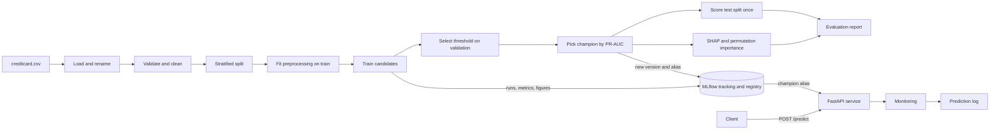
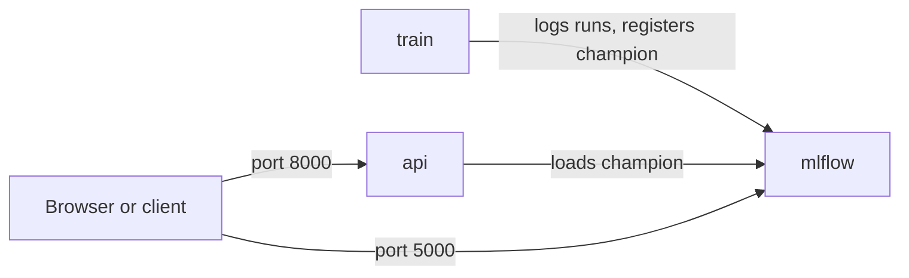

# Architecture

## Overview

fraudguard has two runtime paths that share one Python package, `src/fraudguard`.

- **Training** (`scripts/train_model.py`) loads and validates the raw data, splits it, fits preprocessing and several models, selects a decision threshold, evaluates and explains the best model, and registers it in MLflow.
- **Serving** (`scripts/run_api.py`) loads the model version that the `champion` alias points to and scores transactions over HTTP.

The MLflow model registry is the only interface between the two. The API never reads training outputs from disk. A deployment away from the registry, such as the public demo, gets a bundle exported from it instead; [deployment.md](deployment.md) describes it.

## Modules

| Module | Responsibility |
| --- | --- |
| `config.py` | Typed configuration from `config/config.yaml`, environment overrides, logging setup |
| `data_ingestion.py` | Reading the raw CSV, the canonical schema, stratified splits, the synthetic generator |
| `data_validation.py` | Schema, missing value, duplicate, range, and class balance checks, cleaning, split overlap guard |
| `feature_engineering.py` | Feature builder and the preprocessing pipeline |
| `training.py` | Candidate models, MLflow tracking, champion selection and registration |
| `evaluation.py` | Ranking metrics, threshold table, expected cost, calibration, bootstrap intervals |
| `explainability.py` | SHAP values and permutation importance |
| `plotting.py` | Evaluation and explanation figures |
| `reporting.py` | The Markdown evaluation report |
| `inference.py` | Loading the champion and scoring transactions |
| `bundle.py` | Exporting the champion to a self-contained bundle, loading it, and choosing demo transactions |
| `api.py` | HTTP endpoints, request validation, request logging, error handling, the demo page |
| `monitoring.py` | Prediction log, service metrics, drift detection |

## Training pipeline

1. **Load.** `creditcard.csv` is read and its columns renamed to snake_case. Each row keeps its position in the file as `transaction_id`, so any processed row can be traced back to the source.
2. **Validate.** Blocking checks stop the run: missing or non-numeric columns, more than 5% missing values in a column, more than 1% invalid rows, fewer than 30 fraud rows. Duplicates and an unusual fraud rate are warnings. Every result is logged and written to `reports/validation_report.json`.
3. **Clean.** Invalid rows, exact duplicates, and inputs that appear with both labels are dropped before splitting, so the same transaction cannot end up in two splits.
4. **Split.** 60% train, 20% validation, and 20% test, stratified on the label with a fixed seed. A guard hashes every input vector and stops the run if one appears in more than one split.
5. **Preprocess.** The feature builder, imputer, and scaler are fitted on the training split only, then applied to the other splits. The processed splits and the fitted preprocessor are written to `data/processed/`.
6. **Train candidates.** Every candidate in the configuration is fitted on the training split. SMOTE runs inside an imbalanced-learn pipeline, which resamples during fit only, so validation and test data are never resampled.
7. **Select a threshold** for each candidate on the validation split. The rule is described in the evaluation report.
8. **Select the champion** by validation PR-AUC.
9. **Evaluate on test.** Only the champion is scored on the test split, and only after its model and threshold are fixed.
10. **Explain.** SHAP values and permutation importance are computed on validation data.
11. **Register.** The champion's serving pipeline, preprocessor plus classifier, becomes a new version of the registered model, and the `champion` alias moves to it.

## What MLflow stores

| Item | Content |
| --- | --- |
| Parameters | Algorithm, imbalance strategy, hyperparameters, seed, row counts, cost assumptions |
| Tags | Dataset label and SHA-256 of the data file |
| Metrics | Validation ranking metrics and metrics at the selected threshold; test metrics for the champion |
| Artefacts | ROC, precision-recall, confusion matrix, calibration, and threshold figures, the threshold table, and the full report for the champion |
| Model | Serving pipeline in skops format, with signature and input example |
| Model metadata | Decision threshold and the training profile used for drift detection |
| Registry | Registered model `fraudguard`, one version per training run, alias `champion` on the selected version |

Because the threshold and the drift profile live in the model metadata, they move with the model. The API needs nothing besides the registry.

skops is used instead of pickle because it only rebuilds an explicit list of types when loading.

## Serving

At startup the API resolves the `champion` alias to a version number, then downloads that version. Resolving first means the reported version always matches the loaded files, even if the alias moves during startup. If loading fails, the service still starts: `/health` returns 503 and `/predict` refuses requests until a restart finds a model. When `api.model_bundle` is set, the API loads that bundle instead and never contacts the registry.

| Endpoint | Purpose |
| --- | --- |
| `POST /predict` | Score one transaction. `explain=false` skips the SHAP contributions. |
| `GET /health` | 200 with the model version when a model is loaded, otherwise 503 |
| `GET /metrics` | Prediction counts, flagged rate, latency percentiles, input statistics, and drift status |
| `GET /docs` | Interactive OpenAPI documentation |
| `GET /` | Demo page. It scores the bundled test transactions through `/predict`, as any client would. |
| `GET /demo/examples` | The bundled test transactions and test metrics, empty when the model came from the registry |

Request handling:

- Every request gets an id, taken from the `X-Request-ID` header when it is a plain token of up to 64 characters and generated otherwise. The id is returned in the response and appears in every log line for the request.
- Invalid bodies return 422 with the failing fields. Submitted values are not echoed back.
- Unhandled errors return a generic 500 with the request id. The traceback goes to the log only.
- Prediction runs in a worker thread, so one slow request does not block the event loop.

## Monitoring

`PredictionMonitor` keeps lifetime counters and a rolling window of the latest 5,000 predictions in memory, and appends every prediction to `data/monitoring/predictions.jsonl`.

Drift detection works per feature:

1. At training time, each of `amount` and `v1` to `v28` is cut into 10 bins at training-split quantiles, so every bin holds about 10% of the training rows. The edges and shares are stored with the model.
2. The API places recent requests into the same bins and computes the population stability index, `PSI = sum((actual - expected) * ln(actual / expected))`.
3. The status is `warning` when the largest PSI reaches 0.1 and `alert` when it reaches 0.25. Below 200 recent requests the status is `insufficient_data`, because PSI is noisy on small samples.

Known limits of this local setup:

- State is in memory and per process. It resets on restart and is not shared between replicas.
- Input drift does not show whether the model got worse. That needs fraud labels, which usually arrive weeks later through chargebacks.
- The prediction log grows without bound and holds full inputs. A real deployment needs rotation and a retention policy.

### Extending to Prometheus and Grafana

- Expose counters and histograms with `prometheus_client`, for example `fraudguard_predictions_total` labelled by decision, a latency histogram, a histogram of fraud scores, and an info metric with the model version. Serve them at `/metrics` in the Prometheus text format and move the current JSON summary to another path.
- Compute PSI in a scheduled job that reads the prediction log or a warehouse table, rather than in the API process, and publish it as a gauge per feature.
- Build Grafana panels for request rate, error rate, p95 latency, flagged rate, and PSI per feature. Alert when the flagged rate leaves the band seen on validation data, when any PSI passes 0.25, or when the error rate passes 1%.
- Join fraud labels to the prediction log as they arrive and track precision and recall over time. This is the only direct measure of decay.

## Configuration

All settings live in `config/config.yaml` and are validated with Pydantic at startup. Unknown keys are rejected, so a typo fails fast. Deployment-specific values can be overridden with environment variables or a `.env` file; `.env.example` lists them.

| Variable | Overrides |
| --- | --- |
| `MLFLOW_TRACKING_URI` | `mlflow.tracking_uri` |
| `FRAUDGUARD_MLFLOW_ARTIFACT_DIR` | `mlflow.artifact_dir` |
| `FRAUDGUARD_API_HOST`, `FRAUDGUARD_API_PORT` | `api.host`, `api.port` |
| `FRAUDGUARD_MODEL_BUNDLE` | `api.model_bundle`, a bundle to serve instead of the registry champion |
| `FRAUDGUARD_PREDICTION_LOG_PATH` | `monitoring.prediction_log_path` |
| `FRAUDGUARD_CONFIG_PATH` | Location of the configuration file |
| `FRAUDGUARD_LOG_LEVEL` | Log level |

## Reproducibility

- Every dependency is pinned in `uv.lock`, and resolution is fixed to a date with `exclude-newer`.
- One seed in the configuration drives the split, the models, SMOTE, and sampling for explanations.
- Each run is tagged with the SHA-256 of the data file and logs every setting that affects results.
- The Docker image installs from the same lock file as development and CI.

## Docker Compose stack

| Service | Role |
| --- | --- |
| `mlflow` | Tracking server and registry. SQLite and artefacts live in a named volume. Only the Host headers `mlflow:5000`, `localhost`, and `127.0.0.1` are accepted, which protects against DNS rebinding. |
| `train` | Generates sample data, trains, and registers a champion, then exits. The API starts only after it succeeds. |
| `api` | Serves the champion on port 8000. The prediction log is kept in a named volume. |

All three services use one image and run as an unprivileged user with uid 1000. On Linux, `./data` and `./reports` must be writable by that uid, because the training service writes to them.

## Continuous integration

`.github/workflows/ci.yml` runs on pushes to `main` and on pull requests.

| Job | Steps |
| --- | --- |
| Lint, type check, and test | ruff, format check, mypy in strict mode, pytest with coverage (fails below 90%), then a training run on synthetic data |
| Build and smoke test the image | Builds the image, validates the compose file, trains and serves inside a container, then calls `/health` and `/predict` |
| Build and smoke test the Cloud Run image | Trains on synthetic data, exports a bundle, builds the Cloud Run image from the staged files, and checks `/health`, the demo page, and its examples |

Nothing is deployed automatically. `make deploy` publishes the demo by hand; see [deployment.md](deployment.md).
