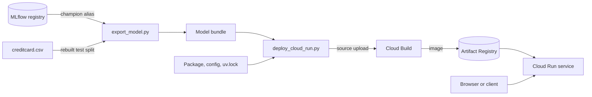

# Deployment

The public demo runs on Google Cloud Run at <https://fraudguard-495192213241.europe-west1.run.app>. This page covers how the model gets there, how to deploy it, and what the deployment does not do.

## Why the registry stays local

The MLflow registry in this repository is a SQLite file whose artefact paths point at the machine that trained the model, so a container elsewhere cannot use it. Hosting a tracking server just to serve one model version would cost more than the demo itself. Instead, the champion is exported to a self-contained bundle and baked into the image.



## The bundle

`make bundle` runs `scripts/export_model.py`, which writes `dist/model_bundle/`:

| File | Content |
| --- | --- |
| `model/` | The registered MLflow model, with the decision threshold and drift profile in its metadata. The absolute artefact path MLflow records is replaced with a relative one. |
| `manifest.json` | Model name and version, algorithm, SHA-256 of the training data, export time, and the champion's test metrics |
| `examples.json` | Six transactions from the test split for the demo page |

The demo transactions come from the test split, rebuilt with the same cleaning and seeded split as training. The script compares the data file's SHA-256 with the one recorded on the training run and stops if they differ, because the rows would then not be the model's test split and could include training data. Within the test split, the examples are chosen by the model's own decisions: two caught frauds, one missed fraud, two approved payments, and one false alarm. The errors are there on purpose; a demo of only correct answers would hide the trade-off the threshold makes.

When `FRAUDGUARD_MODEL_BUNDLE` points at a bundle, the API loads the model from it instead of the registry, and serves the examples and test metrics at `/demo/examples` for the page at `/`. Tests check that a bundled model scores exactly like the registry model it came from.

## One-off setup

Install the [Google Cloud CLI](https://cloud.google.com/sdk/docs/install), then create a project with billing and the APIs that `gcloud run deploy --source` needs:

```bash
gcloud auth login
gcloud projects create PROJECT_ID --name=fraudguard
gcloud config set project PROJECT_ID
gcloud config set run/region europe-west1
gcloud billing projects link PROJECT_ID --billing-account=BILLING_ACCOUNT_ID
gcloud services enable run.googleapis.com cloudbuild.googleapis.com artifactregistry.googleapis.com
```

`gcloud billing accounts list` shows the billing account id.

Cloud Build runs as a default service account, which on a new project may lack permission to build and push the image; the first deploy then fails with `PERMISSION_DENIED`. `gcloud builds get-default-service-account` prints the account, and the Cloud Run Builder role fixes it:

```bash
gcloud projects add-iam-policy-binding PROJECT_ID \
  --member=serviceAccount:BUILD_SERVICE_ACCOUNT --role=roles/run.builder
```

A budget alert emails the billing admins when spending passes a threshold. It does not stop the service; the single-instance limit is what bounds the cost.

```bash
gcloud services enable billingbudgets.googleapis.com
gcloud billing budgets create --billing-account=BILLING_ACCOUNT_ID \
  --display-name='fraudguard demo' --budget-amount=5GBP \
  --threshold-rule=percent=0.5 --threshold-rule=percent=0.9 --threshold-rule=percent=1.0 \
  --filter-projects=projects/PROJECT_ID
```

## Deploying

```bash
make bundle   # after training, exports the champion
make deploy   # builds the image in Cloud Build and rolls out a new revision
```

`scripts/deploy_cloud_run.py` refuses to deploy uncommitted changes, so the running service always matches a commit. It stages the package, configuration, lock file, bundle, and [deploy/cloud_run/Dockerfile](../deploy/cloud_run/Dockerfile) in `dist/cloud_run`, and runs `gcloud run deploy --source` on that directory. The revision is labelled with the commit and the model version, and the script finishes by calling `/health` on the new revision.

| Setting | Value | Reason |
| --- | --- | --- |
| CPU and memory | 1 vCPU, 1 GiB | The service uses about 360 MB after loading the model |
| Instances | 0 to 1 | Scales to zero when idle; one instance bounds the cost of any traffic spike |
| Startup CPU boost | On | Shortens cold starts, which load MLflow, SHAP, and the model |
| Access | Public | It is a demo; anyone can call it |

CI builds the same image from a model trained on synthetic data on every push and checks `/health`, the demo page, and its examples. Deploying stays a manual step, so no cloud credentials are stored in GitHub.

## Limits

- **Cold starts.** With no traffic the service scales to zero, and the first request after that waits for a container to start. In the first deployment's logs that took 17 seconds from instance start to ready, of which loading the model took under 2; the rest was pulling the image and starting Python. Warm requests take milliseconds.
- **State resets.** The prediction log and the counters behind `/metrics` live in the container, so they reset whenever an instance stops. Durable monitoring would write to Cloud Logging or a database.
- **No authentication or rate limit.** Any client can call `/predict`. The single-instance cap limits cost, not abuse. Do not send real card data.
- **Frozen model.** The image holds one model version. Retraining changes nothing online until the bundle is exported and deployed again.
