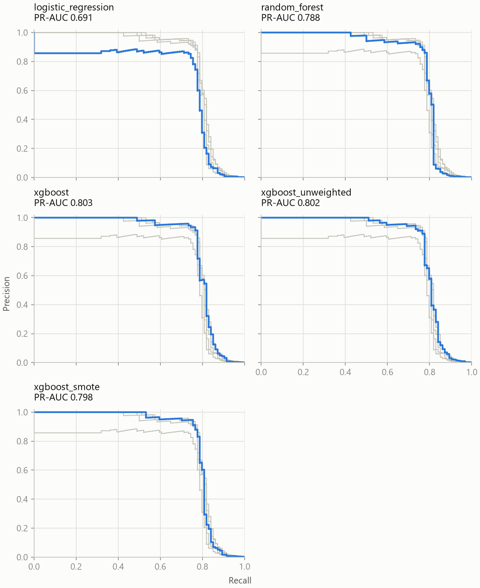
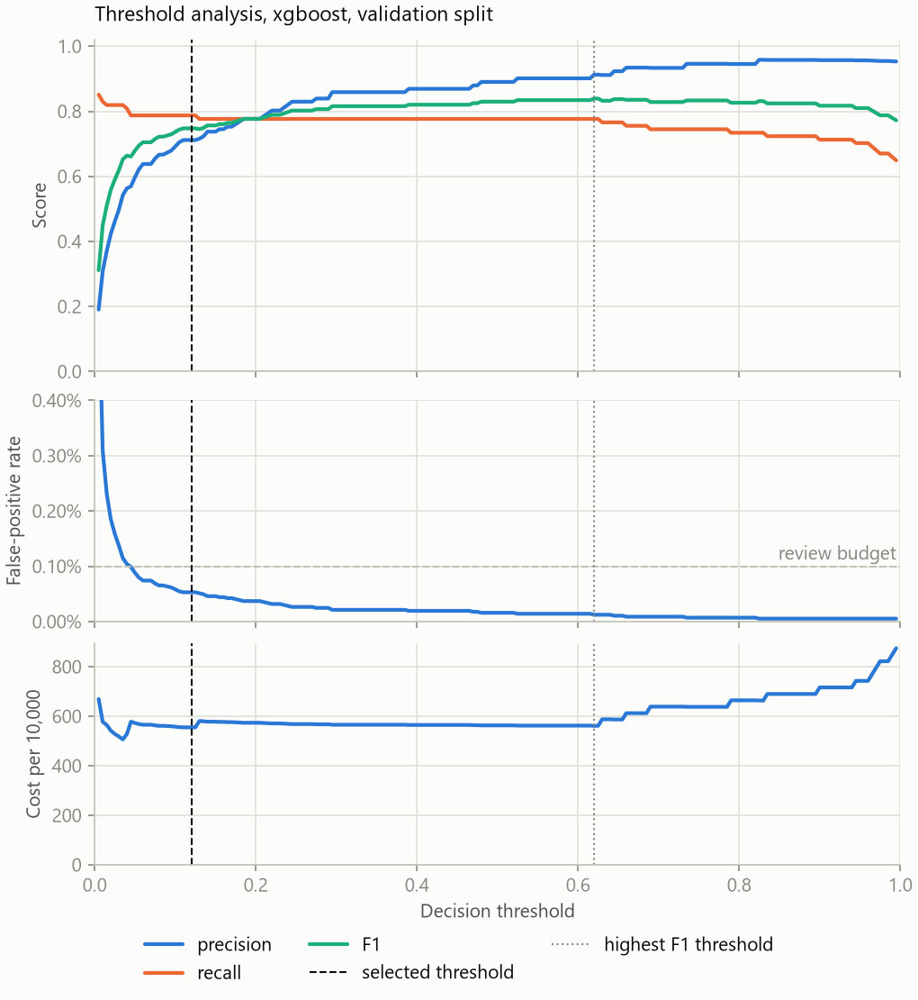
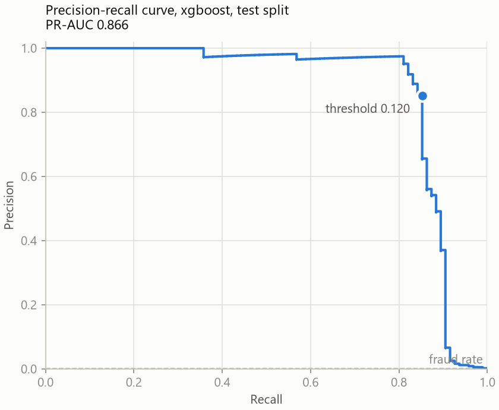
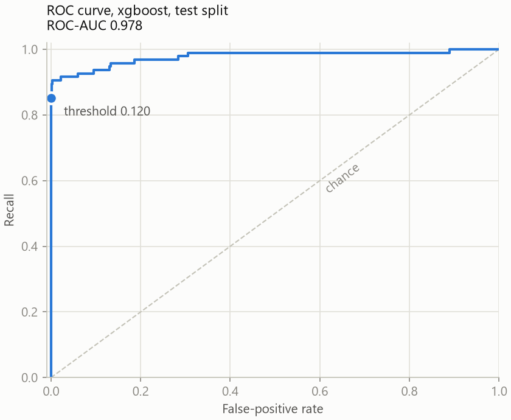
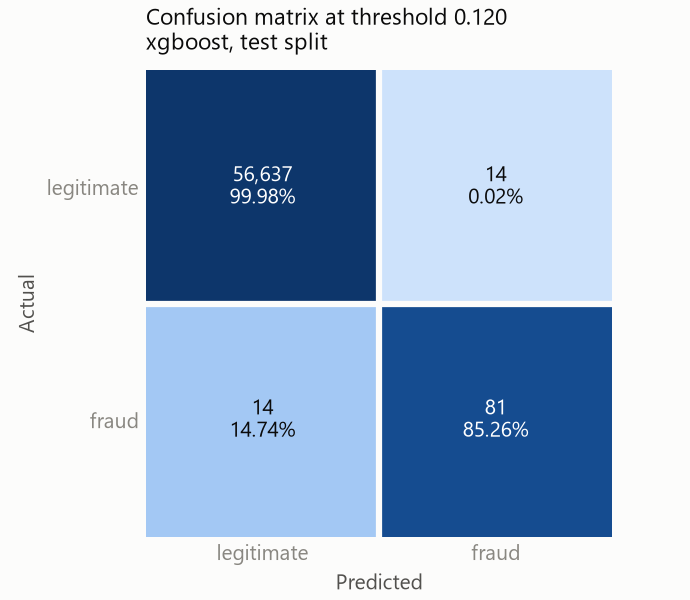
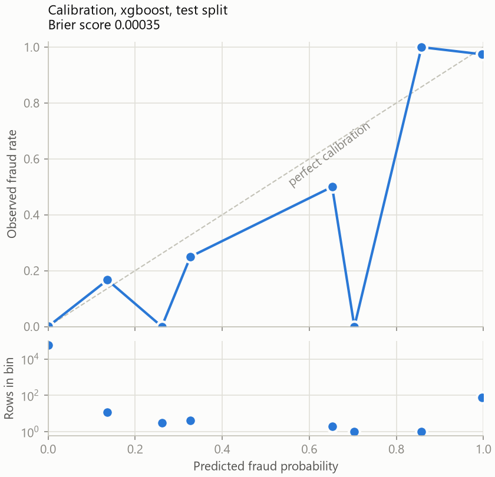
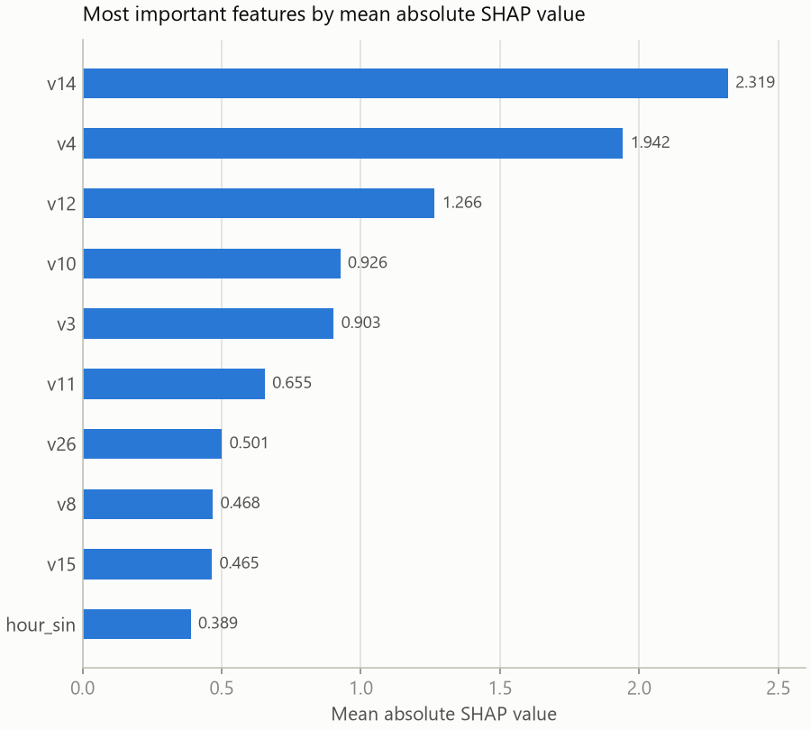
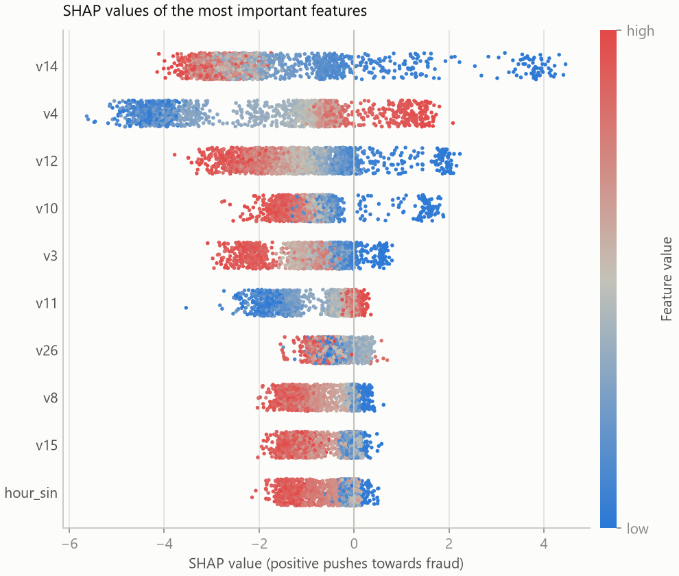
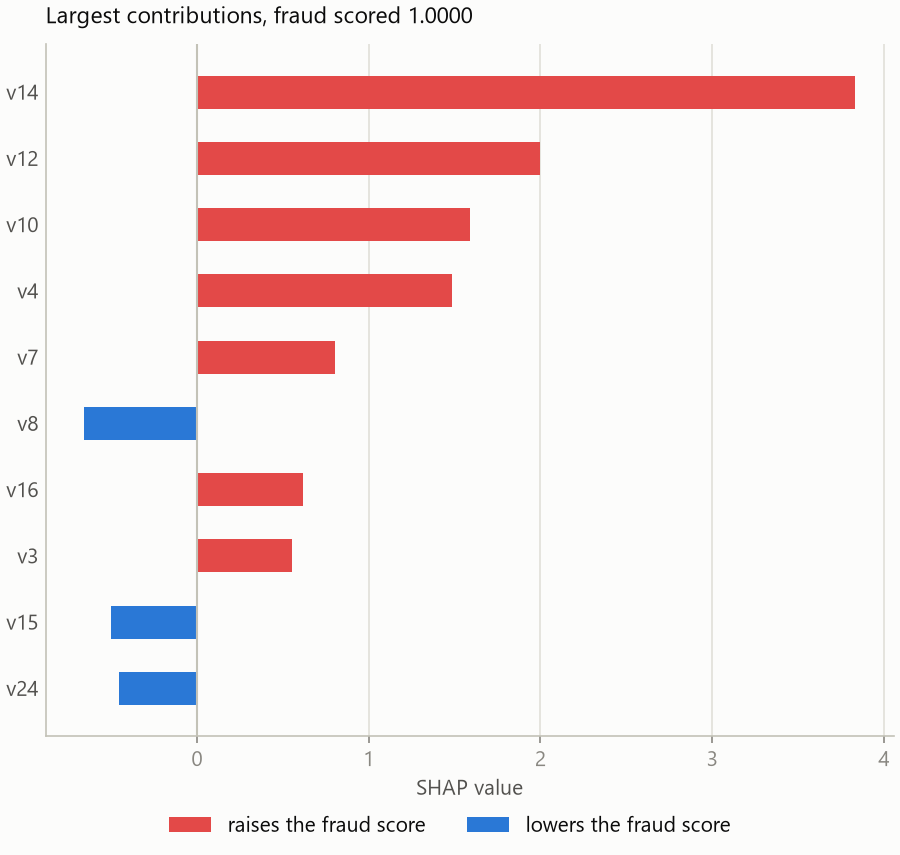
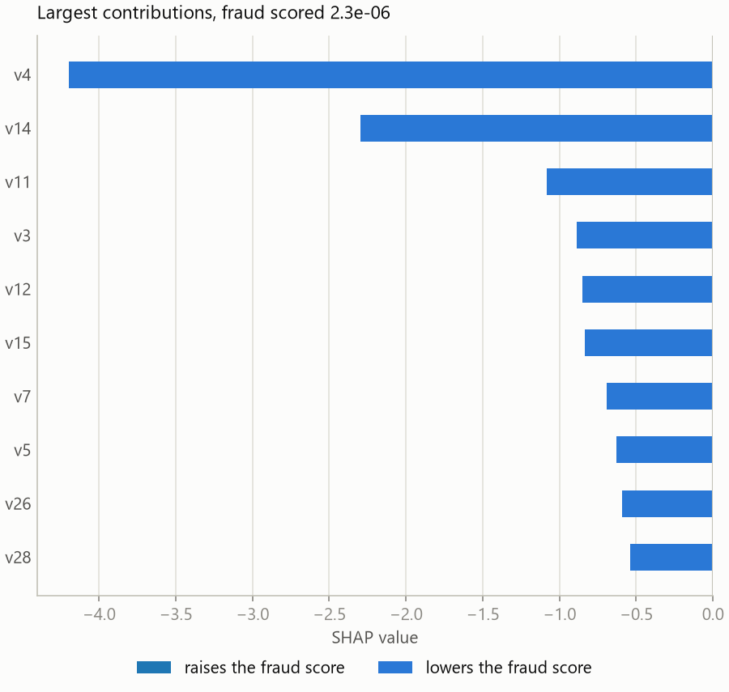

# Evaluation report

Generated by `scripts/train_model.py`. Rerun training to refresh it instead of editing by hand.

## Summary

| Item | Value |
| --- | --- |
| Dataset | creditcard.csv (sha256 `76274b691b16`) |
| Champion model | `xgboost`, registry version 1 |
| Selection metric | PR-AUC on the validation split |
| Decision threshold | 0.120 |
| Test PR-AUC | 0.866 (95% interval 0.800 to 0.929) |
| Test ROC-AUC | 0.978 (95% interval 0.953 to 0.994) |
| Test recall at threshold | 0.853 (95% interval 0.783 to 0.922) |
| Test precision at threshold | 0.853 (95% interval 0.780 to 0.922) |
| Test false-positive rate | 0.025% |
| Test cost per 10,000 transactions | 382, against 2,511 with no model |

## Data

| Step | Rows |
| --- | --- |
| Rows in the raw file | 284,807 |
| Invalid rows dropped | 0 |
| Exact duplicates dropped | 1,081 |
| Rows with conflicting labels dropped | 0 |
| Rows used | 283,726 |

Validation checks on the raw file:

| Check | Status | Result |
| --- | --- | --- |
| schema | passed | All 31 required columns present |
| missing_values | passed | No missing input values |
| duplicates | warning | 1,081 duplicate rows (0.38%) will be dropped before splitting |
| value_ranges | passed | All values within valid ranges |
| class_balance | passed | 492 fraud rows (0.173%) |

Stratified splits of the cleaned data:

| Split | Rows | Fraud rows | Fraud rate |
| --- | --- | --- | --- |
| train | 170,235 | 284 | 0.167% |
| validation | 56,745 | 94 | 0.166% |
| test | 56,746 | 95 | 0.167% |

Duplicates are removed before splitting, and a check confirms that no input vector appears in more than one split. The imputer and scaler are fitted on the training split only.

## Model comparison

All candidates were trained on the same training split and compared on the validation split. The test split played no part in any decision. Thresholds, precision, recall, and cost are at the threshold chosen for each candidate by the rule described below.

| Candidate | Imbalance handling | PR-AUC | ROC-AUC | Brier | Threshold | Precision | Recall | F1 | FPR | Cost per 10k | Fit (s) |
| --- | --- | --- | --- | --- | --- | --- | --- | --- | --- | --- | --- |
| `logistic_regression` | class_weight | 0.6913 | 0.9612 | 0.02307 | 0.990 | 0.574 | 0.787 | 0.664 | 0.097% | 577 | 0.5 |
| `random_forest` | class_weight | 0.7879 | 0.9532 | 0.00060 | 0.165 | 0.576 | 0.809 | 0.673 | 0.099% | 525 | 30.7 |
| `xgboost` | scale_pos_weight | 0.8031 | 0.9654 | 0.00050 | 0.120 | 0.712 | 0.787 | 0.747 | 0.053% | 555 | 4.0 |
| `xgboost_unweighted` | none | 0.8016 | 0.9717 | 0.00052 | 0.010 | 0.630 | 0.798 | 0.704 | 0.078% | 541 | 3.6 |
| `xgboost_smote` | smote | 0.7984 | 0.9703 | 0.00051 | 0.105 | 0.585 | 0.809 | 0.679 | 0.095% | 523 | 5.0 |

`xgboost` was selected because it has the highest validation PR-AUC (0.8031). The runner-up, `xgboost_unweighted`, scored 0.8016. The gap is small for a validation split with 94 fraud cases, so the order of these two could change with a different split.

PR-AUC is the selection metric because it measures ranking quality on the fraud class across all thresholds. ROC-AUC is reported as well, but it is inflated by the large number of easy legitimate transactions.

Expected cost at the threshold chosen for each candidate ranges from 523 to 577 per 10,000 transactions. One more missed fraud adds 26 on this split, so the whole spread equals about 2.0 fraud cases. A ranking that depends on so few cases would mostly reflect noise, which is why candidates are compared on PR-AUC and cost is used only to set the threshold.

## Why accuracy is not used

Test accuracy of the champion at its threshold is 99.951%. A rule that flags nothing reaches 99.833% on the same data while catching no fraud at all. Accuracy cannot tell these two apart, so it is not used for model selection, threshold selection, or reporting in this project.

## Threshold selection

The threshold follows from three business assumptions, all set in `config/config.yaml`:

- A missed fraud costs 150 on average: the loss plus chargeback handling.
- A false alert costs 5: review effort and customer friction.
- The review team can absorb false alerts on at most 0.10% of legitimate transactions.

Rule: among thresholds whose validation false-positive rate fits the review budget, take the one with the lowest expected cost. If several tie, take the middle of the tied range, which is less sensitive to small score shifts.

Validation metrics of the champion across thresholds:

| Threshold | Precision | Recall | F1 | FPR | Cost per 10k | Note |
| --- | --- | --- | --- | --- | --- | --- |
| 0.035 | 0.542 | 0.819 | 0.653 | 0.115% | 507 | lowest cost without the budget |
| 0.050 | 0.597 | 0.787 | 0.679 | 0.088% | 573 |  |
| 0.100 | 0.692 | 0.787 | 0.736 | 0.058% | 558 |  |
| 0.120 | 0.712 | 0.787 | 0.747 | 0.053% | 555 | selected |
| 0.200 | 0.777 | 0.777 | 0.777 | 0.037% | 574 |  |
| 0.300 | 0.859 | 0.777 | 0.816 | 0.021% | 566 |  |
| 0.400 | 0.869 | 0.777 | 0.820 | 0.019% | 565 |  |
| 0.500 | 0.890 | 0.777 | 0.830 | 0.016% | 563 |  |
| 0.600 | 0.901 | 0.777 | 0.834 | 0.014% | 562 |  |
| 0.620 | 0.912 | 0.777 | 0.839 | 0.012% | 561 | highest F1 |
| 0.700 | 0.933 | 0.745 | 0.828 | 0.009% | 639 |  |
| 0.800 | 0.945 | 0.734 | 0.826 | 0.007% | 664 |  |
| 0.900 | 0.957 | 0.713 | 0.817 | 0.005% | 716 |  |
| 0.950 | 0.957 | 0.702 | 0.810 | 0.005% | 743 |  |

The selected threshold is **0.120**. Without the review budget the cheapest threshold would be 0.035, so the budget is the binding constraint.

Maximising F1 would give a threshold of 0.620: recall 0.777 against 0.787, false-positive rate 0.012% against 0.053%, and cost per 10,000 transactions 561 against 555. F1 weighs a missed fraud and a false alert equally, which does not match the costs above.

Lowering the threshold catches more fraud but blocks more legitimate customers and sends more cases to review. Raising it does the opposite. The costs above are assumptions, and the threshold should be re-derived whenever they change.

## Test results

The test split was scored once, after the model and the threshold were fixed.

|  | Predicted legitimate | Predicted fraud |
| --- | --- | --- |
| Actual legitimate | 56,637 | 14 |
| Actual fraud | 14 | 81 |

| Metric | Value | 95% bootstrap interval |
| --- | --- | --- |
| PR-AUC | 0.8658 | 0.800 to 0.929 |
| ROC-AUC | 0.9777 | 0.953 to 0.994 |
| Precision | 0.8526 | 0.780 to 0.922 |
| Recall | 0.8526 | 0.783 to 0.922 |
| F1 | 0.8526 |  |
| False-positive rate | 0.025% |  |
| False-negative rate | 14.74% |  |
| Brier score | 0.00035 |  |
| Cost per 10,000 transactions | 382 | 199 to 568 |

The test split holds 95 fraud cases, so a single case moves recall by 1.1%. The intervals are wide for that reason, and small differences between models or thresholds should not be read as real.

On the validation split the champion reached PR-AUC 0.803, precision 0.712, and recall 0.787 at the same threshold. The validation PR-AUC lies inside the test interval, so the difference between the splits is within sampling noise. Expect new data to land somewhere in that range rather than at either point estimate.

The same test scores at other operating points, for comparison only:

| Operating point | Threshold | Precision | Recall | FPR | Cost per 10k |
| --- | --- | --- | --- | --- | --- |
| Selected threshold | 0.120 | 0.853 | 0.853 | 0.025% | 382 |
| Highest validation F1 | 0.620 | 0.951 | 0.821 | 0.007% | 453 |
| Default 0.5 | 0.500 | 0.951 | 0.821 | 0.007% | 453 |
| No model, nothing flagged |  |  | 0.000 | 0.000% | 2,511 |

## Calibration

The Brier score on the test split is 0.00035. A constant prediction equal to the fraud rate would score 0.00167. The Brier score is dominated by the legitimate majority, so the calibration curve is the more useful view.

Bins at high predicted probability hold few rows and are noisy.

The champion was trained with `scale_pos_weight`, which pushes predicted probabilities upwards relative to the true fraud rate. Treat the score as a ranking signal, not as a literal probability. The threshold is chosen empirically from validation outcomes, so it does not rely on calibration.

## Explainability

SHAP values were computed for 2,000 validation rows: every fraud case plus a random sample of legitimate transactions. A plain random sample would contain too few fraud cases to show how the model detects them, so the ranking below is not weighted by how common each class is. Permutation importance is the drop in validation average precision when a feature is shuffled, and it serves as a model-agnostic cross-check.

| Rank | Feature | Mean absolute SHAP | Permutation importance | Permutation rank |
| --- | --- | --- | --- | --- |
| 1 | `v14` | 2.3190 | 0.1163 | 1 |
| 2 | `v4` | 1.9420 | 0.0811 | 2 |
| 3 | `v12` | 1.2656 | 0.0439 | 3 |
| 4 | `v10` | 0.9259 | 0.0178 | 6 |
| 5 | `v3` | 0.9026 | 0.0379 | 4 |
| 6 | `v11` | 0.6550 | 0.0301 | 5 |
| 7 | `v26` | 0.5010 | -0.0009 | 31 |
| 8 | `v8` | 0.4683 | 0.0014 | 25 |
| 9 | `v15` | 0.4650 | 0.0112 | 8 |
| 10 | `hour_sin` | 0.3885 | 0.0100 | 9 |

8 of the 10 top SHAP features are also in the permutation top 10. Of the engineered amount and time features, `hour_sin` ranks in the top 10.

`v1` to `v28` are principal components of the original transaction attributes, released in that form to protect confidentiality. The model can say that a component such as the top-ranked one drove a score, but nobody outside the data owner can say what that component means. Explanations are therefore useful for debugging and for checking stability, not for telling a customer why a payment was declined. Only the amount and time-of-day features have a direct meaning.

### Local explanations

Contributions are in log-odds units and values are standardised model inputs. A positive contribution raises the fraud score.

Detected fraud, scored 1.0000:

| Feature | Standardised value | Contribution |
| --- | --- | --- |
| `v14` | -14.30 | +3.833 |
| `v12` | -13.14 | +1.999 |
| `v10` | -11.94 | +1.588 |
| `v4` | +6.28 | +1.487 |
| `v7` | -10.57 | +0.806 |
| `v8` | +5.73 | -0.657 |
| `v16` | -12.55 | +0.618 |
| `v3` | -8.80 | +0.553 |
| `v15` | +1.04 | -0.502 |
| `v24` | +0.79 | -0.454 |

Missed fraud, scored 2.3e-06:

| Feature | Standardised value | Contribution |
| --- | --- | --- |
| `v4` | -0.92 | -4.195 |
| `v14` | +0.23 | -2.299 |
| `v11` | -0.64 | -1.083 |
| `v3` | -0.11 | -0.885 |
| `v12` | -0.00 | -0.850 |
| `v15` | +0.97 | -0.836 |
| `v7` | +2.55 | -0.690 |
| `v5` | -1.40 | -0.631 |
| `v26` | -1.13 | -0.590 |
| `v28` | -0.36 | -0.538 |

The missed case is the fraud with the lowest score in the validation split. Its inputs sit close to those of ordinary transactions, which is the main way this model fails.

## Business trade-offs

- **Missing fraud.** At the selected threshold the model misses 14 of 95 fraud cases in the test split (14.7%). Each one is a direct loss plus chargeback handling.
- **Blocking legitimate transactions.** 14 of 56,651 legitimate test transactions are flagged. Each is a customer whose payment is declined or challenged for no reason.
- **Customer friction.** A hard decline costs more goodwill than a step-up check such as a one-time code. The false-alert cost assumes a mix of both. If every alert became a hard decline, the cost of a false alert would be higher and the threshold should rise.
- **Operational review cost.** The threshold produces about 16.7 alerts per 10,000 transactions, of which 85% are fraud. Review staffing has to match that volume, and the review budget in the configuration caps it.

## Limitations

- The public dataset covers two days of transactions by European cardholders in September 2013. Fraud patterns, payment methods, and fraud rates have changed since.
- The split is random and stratified. It does not test how the model holds up on later transactions, which is what matters in production. Two days of data are too short for a meaningful out-of-time test.
- Fraud cases are few, so every estimate is uncertain and the threshold itself is fitted to a small sample.
- The inputs are anonymised principal components. There are no card, customer, or merchant identifiers, so velocity and history features, usually the strongest fraud signals, cannot be built.
- Labels reflect fraud that was confirmed at the time. Undetected fraud is labelled legitimate, and the delay between a transaction and its label is not modelled.
- Costs are fixed per error. Real losses depend on the transaction amount, and real friction depends on the customer.
- No demographic or geographic attributes are available, so fairness across customer groups cannot be assessed. That assessment is required before any real deployment.
- Exact duplicate rows are treated as data errors and dropped. Some may have been real repeated transactions.

## Potential failure modes

- **Concept drift.** Fraudsters adapt. A model trained on old patterns loses recall without any visible error. Input drift is monitored with PSI, but only fresh labels can confirm a drop in performance.
- **Changes upstream.** The principal components come from a transformation the model does not control. If it is refitted, the inputs keep their names but change meaning.
- **Fraud that looks ordinary.** Low-intensity fraud with typical amounts and components scores low, as the missed example shows.
- **Threshold decay.** If the fraud rate or the score distribution shifts, the fixed threshold no longer gives the precision and alert volume it was chosen for.
- **Feedback loops.** Blocked transactions never complete, so their true labels are never observed. Retraining only on outcomes the model allowed biases the next model.
- **Stale or wrong champion.** The service loads the champion alias at startup. Moving the alias to a weaker version, or forgetting to restart, serves the wrong model.
